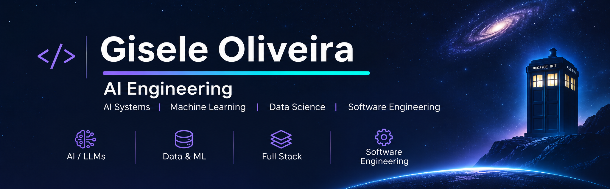
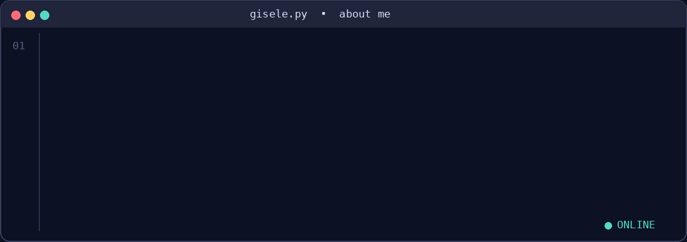

  

---

## 👩‍💻 Sobre mim

Atuo com **Machine Learning, Ciência de Dados e Desenvolvimento Full Stack**, construindo aplicações inteligentes, sistemas orientados a dados e soluções integradas a ambientes corporativos.

Minha experiência envolve o desenvolvimento de sistemas com **LLMs, arquiteturas RAG, agentes conversacionais e de voz**, além de aplicações de Machine Learning, NLP e visão computacional.

Em Ciência de Dados, trabalho com análise exploratória de dados (EDA), preparação de datasets, engenharia de atributos, treinamento, avaliação e otimização de modelos.

Na Engenharia de Software, desenvolvo aplicações backend e frontend utilizando **Python, FastAPI, TypeScript, React, Next.js, Node.js e NestJS**, integrando APIs RESTful, webhooks, bancos de dados e pipelines de dados.

Atualmente, exerço **liderança técnica de uma equipe de IA e desenvolvimento**, participando de decisões de arquitetura, organização de projetos, revisão de implementações, testes e segurança.

Meu foco é conectar **Inteligência Artificial, Ciência de Dados e Engenharia de Software** para desenvolver produtos tecnológicos confiáveis, escaláveis e aplicáveis a problemas reais.

## 🚀 Projetos e experiências relevantes

### 📞 Agente de Voz com IA

Participei no desenvolvimento de uma plataforma de automação de chamadas com agentes de IA, integrando processamento de áudio, modelos de linguagem, telefonia e sistemas corporativos.

**Arquitetura e engenharia:**

- Plano de controle desenvolvido com PHP e MySQL.
- Serviços de mídia utilizando Python e FastAPI.
- Integração com protocolos SIP e RTP.
- Pipeline de voz: STT → GPT-4.1 → TTS.
- Integrações com OpenAI e ElevenLabs.
- Consultas a APIs corporativas em tempo real.
- Filas transacionais, controle de concorrência e idempotência.
- Leases, fencing tokens e controle de capacidade.
- Testes automatizados, integração contínua e observabilidade.
- Segurança aplicada ao tratamento de dados sensíveis.

### 💬 Conversational AI

Desenvolvimento e evolução de agentes conversacionais integrados a sistemas de atendimento.

- Integração de LLMs com APIs e sistemas corporativos.
- Consulta a informações de produtos e serviços.
- Engenharia de prompts e fluxos conversacionais.
- Avaliação de respostas e testes de comportamento.
- Estratégias para mitigar respostas não fundamentadas.

### 🧪 [MCP Chaos Lab](https://github.com/giseleoliver9/mcp_chaos_labs)
**AI Agent Reliability | MCP | Fault Injection**

Laboratório experimental para avaliar a confiabilidade de agentes de IA diante de falhas em ferramentas MCP.

- Simulação de falhas e indisponibilidade de ferramentas.
- Estratégias de recuperação e tolerância a falhas.
- Testes automatizados e métricas reproduzíveis.
- Análise de confiabilidade e segurança.

**Benchmark experimental:**

| Métrica | Baseline | Advanced |
|:---|:---:|:---:|
| Taxa de sucesso | 25% | 75% |
| Execuções | 100 | 100 |

**Resultado:** melhoria de 50 pontos percentuais na taxa de sucesso nas condições avaliadas.

### 📚 [Pegasus Knowledge AI](https://github.com/giseleoliver9/pegasus-knowledge-ai)
**RAG | NLP | Information Retrieval**

Sistema de recuperação e geração de conhecimento a partir de documentos.

- Processamento de PDFs e chunking.
- Geração de embeddings semânticos.
- Recuperação híbrida com busca semântica e TF-IDF.
- Geração de respostas fundamentadas em trechos recuperados.
- Python e Sentence Transformers.

### 🔬 Outros projetos

- [**SafeRepo**](https://github.com/giseleoliver9/SafeRepo): segurança e detecção de informações sensíveis em repositórios.
- [**Clinical ML Benchmark**](https://github.com/giseleoliver9/clinical-ml-benchmark-breast-cancer): avaliação, comparação e interpretabilidade de modelos de ML.
- [**AutiGest**](https://github.com/giseleoliver9/Autigest): tecnologia assistiva com visão computacional.
- [**Leia.AI**](https://github.com/giseleoliver9/Leia_AI): sistema de recomendação de livros e ciência de dados.

---

## 🛠️ Tecnologias & ferramentas

### AI Engineering & LLMs

### Machine Learning & Data Science

### Deep Learning, NLP & Computer Vision

### Backend & Software Engineering

### Frontend & UI

### Databases & Infrastructure

---

## 🎓 Formação & certificações

### Formação acadêmica

- **Análise e Desenvolvimento de Sistemas** — IBMR, concluído em 2025.
- **Pós-graduação em Inteligência Artificial e Data Science** — FETES, em andamento, conclusão prevista para 2027.

### Certificações e formações concluídas

| Certificação / Formação | Instituição | Ano |
|:---|:---|:---:|
| Oracle Cloud Infrastructure AI Foundations Associate | Oracle | 2026 |
| Claude 101 | Anthropic | 2026 |
| Ética em Inteligência Artificial | Enap | 2026 |
| Digital Safety and Security Awareness | Cisco | 2026 |
| Bootcamp de Desenvolvimento de Software | Instituto Matera | 2026 |
| Google Data Analytics Professional Certificate | Google | 2023 |
| Formação em Ciência de Dados | Alura | 2024 |
| Formação Python para Data Science | Alura | 2024 |
| Bootcamp Machine Learning | Atlântico Avanti | 2024 |
| Formação Google Looker Studio | Alura | 2024 |

### 📚 Currently Learning

**AI Engineering & Machine Learning**

- [Machine Learning Specialization](https://www.coursera.org/specializations/machine-learning-introduction) — Stanford Online & DeepLearning.AI
- [Desenvolvimento e Orquestração com IA Generativa](https://cursos.alura.com.br/formacao-desenvolvimento-e-orquestracao-com-ia-one) — Alura / ONE
- [Engenharia de Agentes e Automação com IA](https://cursos.alura.com.br/formacao-engenharia-de-agentes-e-automacao-com-ia-one) — Alura / ONE
- [Inteligência de Dados e RAG Avançado](https://cursos.alura.com.br/formacao-inteligencia-de-dados-e-rag-avancado-one) — Alura / ONE

**Cybersecurity & Project Management**

- [Google Cybersecurity](https://www.coursera.org/specializations/google-cybersecurity) — Google
- [Google Project Management](https://www.coursera.org/specializations/gestao-de-projetos-do-google) — Google
- Mulheres no Futuro: Dados & IA — USP
- Programa CiberEducação Cisco Brasil — Cisco

---

## 🌌 Além do código

Sou **escritora**, participei de algumas antologias e publiquei em revistas virtuais. Recentemente, fiquei entre os 26 selecionados no Prêmio Rio de Contos. 

Tenho formação complementar em Escrita Criativa pela PUCRS, e sou entusiasta de astronomia, apaixonada pela leitura, boardgames e ficção científica. 

Participo da liderança de uma equipe em um projeto de **Caça a Asteroides relacionado ao MCTI e à NASA**, conectando meu interesse por ciência, pesquisa e tecnologia.

Também tenho interesse em projetos multidisciplinares que envolvam desenvolvimento tecnológico, criatividade e impacto social. Por isso, sempre estou participando de eventos, hackathons e projetos. 

---

## 📬 Contato

