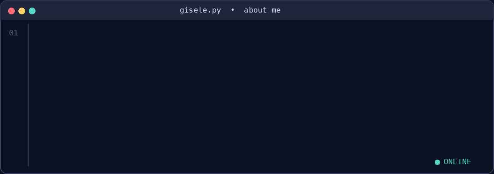

  

**IA Generativa • Agentes de Voz • RAG • Machine Learning • Engenharia de Software**

## Olá! 👋

Atuo com **Inteligência Artificial e desenvolvimento de software**, com experiência em **liderança técnica**, agentes conversacionais e de voz, integração de LLMs, APIs e sistemas corporativos. Meu trabalho combina arquitetura, engenharia, testes e segurança para transformar modelos em aplicações utilizáveis.

  

### 💼 Experiência em engenharia de IA

**Liderança Técnica de IA | Grupo DDM** · Desde nov/2025

- Liderança técnica, priorização de demandas, revisão de implementações e interface com áreas de negócio.
- Desenvolvimento e evolução de agentes de IA para atendimento e operações corporativas.
- Integração com CRM, WhatsApp, APIs, telefonia, bancos de dados e serviços de LLM.
- Testes de integração, validação de regras, observabilidade, proteção de dados e investigação de falhas.

**Desenvolvimento web | OZ Filmes** · Projetos desde jan/2025

- Desenvolvimento de interfaces e aplicações web, integrações, levantamento de requisitos e evolução de funcionalidades.

## 🚀 Projetos e experiências relevantes

### 📞 Plataforma de discagem com agente de voz por IA · Solução corporativa

Participação no desenvolvimento de uma plataforma de automação de chamadas com IA, com integração a sistemas corporativos e telefonia. Fluxo de voz em tempo real e consulta de condições via APIs.

**Arquitetura:** controle em **PHP/MySQL** e serviços de mídia em **Python/FastAPI**; **SIP/RTP** e pipeline **STT → LLM → TTS**. Experiência com filas, idempotência, controle de concorrência e capacidade, testes automatizados, CI e segurança de informações sensíveis.

> Projeto corporativo: código-fonte e detalhes confidenciais não são públicos.

### 🧪 [MCP Chaos Lab](https://github.com/giseleoliver9/mcp_chaos_labs) · Agent Reliability

Laboratório de avaliação de agentes que utilizam ferramentas MCP, incluindo injeção de falhas, recuperação e métricas reproduzíveis.

**Benchmark:** taxa de sucesso de **25% para 75%**, em **100 execuções por configuração** nas condições testadas.

`MCP` `AI Agents` `Testing` `Reliability`

### 📚 [Pegasus Knowledge AI](https://github.com/giseleoliver9/pegasus-knowledge-ai) · Document RAG

Pipeline de documentos PDF com chunking, embeddings, busca híbrida (semântica + TF-IDF) e respostas fundamentadas em trechos recuperados.

`Python` `Sentence Transformers` `RAG` `Hybrid Search`

### 🔍 Outros projetos

- **[SafeRepo](https://github.com/giseleoliver9/SafeRepo):** segurança de repositórios e detecção de informações sensíveis.
- **[Clinical ML Benchmark](https://github.com/giseleoliver9/clinical-ml-benchmark-breast-cancer):** comparação e interpretabilidade de modelos de ML.
- **[AutiGest](https://github.com/giseleoliver9/Autigest):** tecnologia assistiva com visão computacional.
- **[Leia.AI](https://github.com/giseleoliver9/Leia_AI):** recomendação de livros e ciência de dados.

## 🛠️ Tecnologias & ferramentas

**AI • Machine Learning • Data**

**Backend • APIs • Databases**

**Frontend • UI**

**DevOps • Automation • Security**

## 🏅 Formação e certificações

- **Análise e Desenvolvimento de Sistemas** · IBMR (concluído em 2025).
- **Pós-graduação em Inteligência Artificial e Data Science** · FETES (em andamento; conclusão prevista para 2027).
- **Oracle Cloud Infrastructure Certified AI Foundations Associate** · 2026.
- **Cisco Digital Safety and Security Awareness** · 2026.
- **Formação em Ciência de Dados** · Alura, 2024.
- **Bootcamp Machine Learning** · Atlântico Avanti, 2024.

## 🌌 Além do código

Também sou **escritora**, apaixonada por **leitura, astronomia, board games e hackathons**. Participo da liderança de uma equipe em projeto de **caça a asteroides relacionado ao MCTI e à NASA**. Gosto de projetos que aproximam ciência, tecnologia e criatividade.

## 📬 Contato

