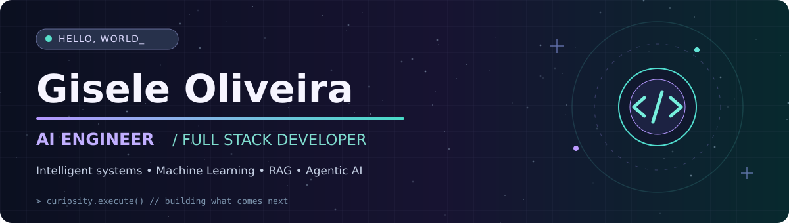
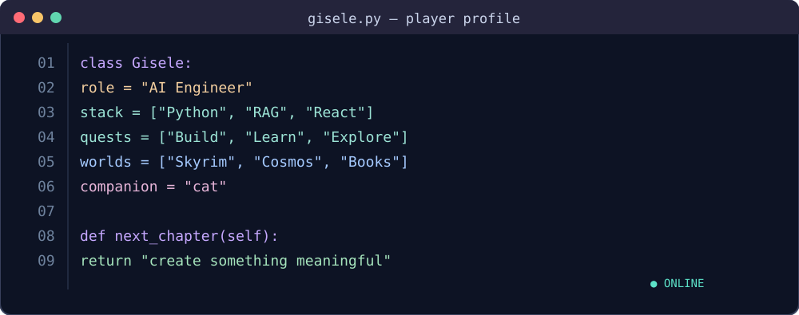

<div align="center">



<br />

[](https://github.com/giseleoliver9?tab=followers)
[](https://github.com/giseleoliver9?tab=repositories)
[](https://www.linkedin.com/in/gisele-o-5b65a810a/)
[](https://medium.com/@giselemeliobr)

**AI Engineering · LLMs & RAG · Machine Learning · Full Stack · Segurança**

</div>

---

## 👩🏻‍💻 Sobre mim

Atuo com **Inteligência Artificial e engenharia de software**, desenvolvendo soluções end-to-end que envolvem agentes conversacionais e de voz, LLMs, RAG, APIs, automação e aplicações web. Também desenvolvo projetos de **Machine Learning, ciência de dados e interfaces Full Stack**.

- **Liderança técnica de IA no Grupo DDM:** priorização, revisão de implementações e integração com áreas de negócio.
- **Engenharia aplicada:** integrações corporativas, avaliação de respostas, testes, análise de latência, observabilidade e proteção de dados.
- **Formação:** Análise e Desenvolvimento de Sistemas (IBMR); pós-graduação em IA e Data Science (FETES, conclusão prevista para jan/2027, conforme currículo fornecido).
- **Em estudo:** arquitetura de software, cybersecurity, cloud computing, visão computacional e robótica.

<div align="center">
  
</div>

---

## 💻 Tech Stack

<div align="center">

**IA, Machine Learning & Dados**


<br />


**Backend & Integrações**


**Frontend, UI & Aplicações**


**Bancos, Cloud & Ferramentas**


</div>

---

## 🏗️ Experiência em engenharia de IA

### Liderança técnica de IA | Grupo DDM

Acompanhamento de demandas, revisão de implementações, priorização técnica e evolução de agentes de IA para operações corporativas. Atuação com **APIs, integrações, avaliação de respostas, testes e segurança de dados**.

### Agentes de voz em produção

Participação no desenvolvimento de uma solução corporativa de chamadas automatizadas com IA, envolvendo **Python/FastAPI, PHP/MySQL, SIP/RTP, STT, GPT-4.1, TTS e integrações por API**.

Foco em desafios de **concorrência, idempotência, filas, limites de capacidade, confiabilidade e rastreabilidade**.

> Experiência profissional apresentada em alto nível. Código e informações internas de clientes não são públicos.

---

## 🚀 Projetos em destaque

### 🔬 [MCP Chaos Lab](https://github.com/giseleoliver9/mcp_chaos_labs)
**Agent Reliability · Fault Injection · MCP**

Laboratório de testes de resiliência de agentes de IA diante de falhas de ferramentas MCP. Em benchmark de 100 execuções por configuração, a taxa de sucesso foi de **25% (baseline) para 75% (abordagem avançada)** nas condições avaliadas.

### 📚 [Pegasus Knowledge AI](https://github.com/giseleoliver9/pegasus-knowledge-ai)
**RAG · Hybrid Search · NLP**

Pipeline de documentos PDF com chunking, embeddings, recuperação híbrida e respostas fundamentadas em trechos recuperados.

### 🛡️ [SafeRepo](https://github.com/giseleoliver9/SafeRepo)
**Security · Developer Tools**

Projeto de análise de repositórios com foco em prevenção da exposição de segredos e informações sensíveis.

### 🧪 [Clinical ML Benchmark](https://github.com/giseleoliver9/clinical-ml-benchmark-breast-cancer)
**Machine Learning · SHAP · Explainability**

Experimentos de classificação e avaliação de modelos com análise de interpretabilidade.

### 🧠 [AutiGest](https://github.com/giseleoliver9/Autigest)
**Computer Vision · Assistive Technology**

Projeto de tecnologia assistiva explorando visão computacional e interações multimodais.

### 📖 [Leia.AI](https://github.com/giseleoliver9/Leia_AI)
**Recommendation Systems · Data Science**

Sistema de recomendação de livros com técnicas de ciência de dados.

---

## 🏅 Certificações & Formação Complementar

<div align="center">


</div>

- **Oracle:** OCI Certified AI Foundations Associate (2026)
- **Cisco:** Digital Safety and Security Awareness (2026)
- **Alura:** Formação em Ciência de Dados (2024)
- **Atlântico Avanti:** Bootcamp Machine Learning (2024)

---

## 🎮 Beyond the Code: Side Quests

Entre linhas de código, mundos fictícios e perguntas sobre o universo. Gosto de **Skyrim e games de mundo aberto, literatura sombria, escrita, ficção científica, astronomia, board games e gatos**.

```python
main_quest = "build intelligent systems"
side_quests = ["explore worlds", "write stories", "study the cosmos", "pet cats"]
current_status = "always learning"
```

---

## 📫 Contato

<div align="center">

<a href="mailto:giselemeliobr2@gmail.com"></a>
<a href="https://www.linkedin.com/in/gisele-o-5b65a810a/"></a>
<a href="https://medium.com/@giselemeliobr"></a>

<sub>Somewhere between a line of code and an unfinished story.</sub>

</div>
